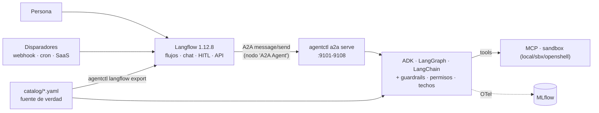

# Langflow como consola: evaluación crítica

**Propuesta evaluada:** usar Langflow como interfaz para manejar y controlar los
agentes heterogéneos de esta plataforma (ADK, LangGraph, LangChain; MCP y A2A;
kagent; MLflow).

**Veredicto:** **sí como consola y como orquestación de borde; no como motor ni
como fuente de verdad.** Langflow llama a los agentes por A2A. Los agentes
siguen siendo manifiestos del catálogo, con su framework, sus guardrails, sus
permisos, su versión y sus evals. La decisión está en
[ADR 0005](adr/0005-langflow-como-consola.md).

Cada afirmación lleva su procedencia: ✅ **verificado** en esta máquina con
Langflow 1.12.8, 📄 **documentado** por el proyecto o ⚠️ **inferido o sin
verificar**.



---

## 1. Arquitectura y desacoplamiento de SDKs

**Qué resuelve:**

- ✅ **Langflow no conoce ningún SDK de agentes.** Cada paso de un flujo es un nodo `A2A Agent` que llama a `agentctl a2a serve`. Que detrás haya ADK, LangGraph o LangChain lo decide el manifiesto (`spec.runtime`), igual que sin Langflow.
- ✅ **Interoperabilidad real entre versiones del protocolo.** Langflow lleva `a2a-sdk 1.2.1` y nuestro servidor está fijado a la serie 0.3 (`a2a-sdk<1`, por kagent). Langflow negocia `a2a-version: 0.3` y la llamada funciona: comprobado con un agente suelto (`tech-explainer`), un secuencial (`tech-article`) y un paralelo (`tech-briefing`).
- ✅ **Los flujos se generan del YAML.** `agentctl langflow export <workflow>` construye el flujo con la misma topología que usan los runtimes (`agent_core/topology.py`). Las plantillas de componentes se leen de la instancia en marcha, así que no se fija a mano el JSON de ninguna versión.

**Riesgos y mitigaciones:**

| Riesgo | Severidad | Mitigación |
|---|---|---|
| **Segunda fuente de verdad.** Los flujos viven en la base de datos de Langflow y cada componente es una copia desacoplada con su versión. Quien edite el flujo en el canvas diverge del YAML. | Alta | El flujo se *genera*: su descripción dice de qué YAML sale y que no se edita allí. Reexportar lo reemplaza. Los cambios de lógica van al catálogo. |
| **Reconstruir agentes como nodos Agent de Langflow** (LangChain). Se pierden los tres runtimes, el enforcement, las versiones y las evals. | Alta | Regla: en Langflow sólo nodos `A2A Agent` hacia el catálogo. Un agente que haga falta se añade al catálogo, no al canvas. |
| **Doble orquestador.** Un `kind: Workflow` dentro de un flujo de Langflow, cada uno con sus reintentos: un fallo puede reintentarse en dos capas. | Media | Un solo orquestador por flujo. Los deterministas son `kind: Workflow`, y Langflow invoca el workflow entero como un agente o lo dibuja exportado, nunca las dos cosas. |
| **Formas que Langflow no expresa.** Un bucle no tiene arista de vuelta. | Baja | ✅ `export` rechaza `review-loop` y explica la salida: invocarlo como un solo agente. |
| **Latencia y serialización de A2A.** | Baja | JSON-RPC por HTTP local añade milisegundos frente a segundos de LLM (✅ `tech-explainer`: 2,1 s de agente). |
| **Sin streaming.** Nuestro `a2a serve` no hace streaming, así que el AG-UI de Langflow (1.11) no verá tokens, sólo la respuesta final. | Baja | Streaming A2A en la Fase 3 (tareas largas). |

**Reemplazabilidad:** el lock-in es **bajo mientras la lógica viva en el
catálogo**. Langflow sólo guarda flujos generados y la frontera es un protocolo
abierto. Cambiar de consola (Flowise, n8n, una propia) es escribir otro `export`.
El lock-in es **alto** si se construyen agentes o lógica en componentes de
Langflow.

## 2. Control de estado y persistencia

**Situación real de la plataforma:**

- **Memoria entre mensajes:** no hay. `a2a serve` no guarda conversación y el host BYO no tiene checkpointer.
- **Historial de ejecución:** las trazas OTel van a MLflow; no existe un almacén de ejecuciones propio.
- **Resiliencia:** reintentos acotados (`agent_core/execution.py`), reintento de respuestas vacías y circuit breaker A2A.
- **Ni checkpoints ni rollback.**

**Lo que aporta Langflow:**

- 📄 Historial de mensajes por `session_id` en su base de datos (aquí Postgres).
- 📄 Checkpoint con estado de **HITL** (1.11). Pero es **entre nodos**: puede pausar antes de llamar a un agente, nunca dentro de una llamada a tool del agente.

**Riesgos:**

| Riesgo | Severidad | Mitigación |
|---|---|---|
| **`message/send` no es idempotente.** Un agente con tools (`python-executor`) puede haber escrito ficheros o abierto un sandbox. | Alta | ✅ **Deduplicación por `messageId`** en `agent_a2a/server.py`: una petición repetida espera a la primera y recibe la misma respuesta sin ejecutar otra vez. Los fallos no se recuerdan. |
| **…pero Langflow genera un `messageId` nuevo en cada llamada** (✅ visto en su código y en la red). Si re-ejecuta un nodo, para nosotros es otra petición. | Media | La deduplicación cubre los reintentos de nuestro cliente, no las re-ejecuciones de Langflow. Hasta tener tareas A2A (`tasks/get`) no se debe poner reintento automático en los nodos A2A de Langflow para agentes con efectos. |
| **Sin rollback de efectos externos.** | Media | Por diseño: los efectos van a un sandbox desechable. La compensación es trabajo de la Fase 3. |
| **Estado repartido** entre el historial de Langflow, las trazas de MLflow y nada en los agentes. | Media | Fase 3: `spec.memory` y un almacén de ejecuciones. Mientras tanto, la conversación es de Langflow y cada llamada a un agente no tiene estado. |

## 3. Gobernanza, seguridad y human-in-the-loop

**Qué se conserva:**

- **El enforcement no se rodea:** guardrails, permisos, techos y presupuesto se aplican dentro del runtime en cada llamada A2A.
- **Aislamiento de ejecución:** el que declare el agente (`spec.sandbox`), con el proveedor que elija el entorno (`local`, `sbx` u `openshell`).

**HITL:**

- 📄 Langflow 1.11 pausa un flujo con estado y espera una decisión humana (llamadas a tools controladas, revisiones). Sirve **entre** pasos: "¿envío este artículo al writer?".
- No puede pausar **dentro** del agente: "¿ejecuto este comando en el sandbox?". Eso necesita `spec.approvals` (Fase 3).

**Riesgos:**

| Riesgo | Severidad | Mitigación |
|---|---|---|
| **Langflow ejecuta Python arbitrario** (componentes propios, editor de código). Antecedente real: **CVE-2025-3248**, RCE sin autenticar en versiones < 1.3. Hay un CVE de 2026 sobre el transporte MCP stdio, ⚠️ sin verificar contra un aviso oficial. | Alta | ✅ Langflow sólo escucha en `127.0.0.1` (7860 y Postgres 5433). Versión fijada (1.12.8). `AUTO_LOGIN` desactivado. Credenciales generadas por máquina y no versionadas. Una instancia por equipo, nunca expuesta. 📄 1.12 restringe a administradores la ejecución de código integrado. |
| **Nuestros servidores A2A no autentican** (Fase 1). Cualquiera que llegue al puerto llama al agente. | Alta | ✅ Sólo en loopback. Langflow usa la red del host para alcanzarlos sin abrirlos a la red. **Condición para salir de local:** OIDC/mTLS en `agent-a2a` (Fase 1). El nodo `A2A Agent` ya admite `x-api-key`. |
| **RBAC inmaduro:** 📄 "foundations" en 1.12. | Media | Una instancia por equipo. Lo que puede hacer cada agente lo decide `permissions` en el manifiesto, no Langflow. |
| **Segundo almacén de secretos** (variables globales de Langflow). | Media | Las claves de modelo y tools viven con los agentes, no en Langflow. En sandbox, OpenShell y sbx sólo exponen marcadores (✅ sbx: `*_API_KEY=proxy-managed`). |
| **SSRF desde el nodo A2A.** | Baja | 📄 Langflow trae protección SSRF con `allow_loopback` activado por defecto. Para hosts fuera de loopback se usa `LANGFLOW_SSRF_ALLOWED_HOSTS` como lista explícita. |

## 4. Observabilidad y evaluación *(eje inferido)*

- ❌ **La traza no es una sola.** ✅ Con la configuración por defecto, Langflow **no envía `traceparent`** en la llamada A2A (comprobado con un servidor espía: llegan `user-agent` y `a2a-version`, nada de W3C trace context). Nuestro servidor sí lo lee, así que la traza del agente en MLflow empieza en el servidor A2A, sin padre.
  - **Mitigación:** activar el tracing OpenTelemetry de Langflow hacia el mismo MLflow y correlacionar por agente y tiempo.
  - **Pendiente de verificar:** si con OTel activado Langflow propaga `traceparent`, la traza se uniría sola.
- **Evals:** `agentctl eval` mide agentes y workflows del catálogo, no flujos de Langflow. Como el flujo exportado reproduce un workflow del catálogo, la suite de ese workflow lo cubre. Un flujo hecho a mano en Langflow no lo cubre nada; es otro motivo para no hacerlos.
- **Coste y tokens:** se cuentan en cada agente (`budget`) y aparecen en sus trazas. Langflow no los ve.

## 5. Operación, escalabilidad y lock-in *(eje inferido)*

| Aspecto | Situación | Qué hacer |
|---|---|---|
| Estado del servidor | Langflow es stateful (flujos, mensajes, claves) | ✅ Postgres desde el principio (`deploy/langflow/compose.yaml`) |
| Versiones | Cambios incompatibles entre series (📄 la 1.11 quitó la contraseña por defecto, entre otros) | ✅ Imagen fijada. Subir de versión es un cambio revisado, y `export` vuelve a generar los flujos con las plantillas nuevas. |
| Entornos | Langflow no tiene equivalente a `configs/environments/` | El flujo se exporta **por entorno**: `--env` decide las URL A2A |
| Promoción | Exportar a JSON es posible (📄 Flow DevOps Toolkit, 1.9) | La fuente es el YAML: se promociona el catálogo y se regeneran los flujos |
| Escalado | Los agentes escalan aparte (un proceso o pod por agente, kagent) | Langflow sólo orquesta: no es el cuello de botella mientras no ejecute lógica |

## Cómo se usa

```bash
make langflow-up                 # Langflow + Postgres, sólo en 127.0.0.1 (credenciales en .agent-platform/)
make a2a-catalog                 # el catálogo por A2A en :9101-9108 (otra terminal)
agentctl --env local-a2a langflow agents                         # qué puede llamar Langflow, y dónde
agentctl --env local-a2a langflow export tech-briefing --run "Kubernetes operators"
make langflow-url                # la URL, el usuario y la clave
```

## Qué no se ha verificado todavía

- Que Langflow propague `traceparent` con su tracing OTel activado.
- HITL de Langflow pausando antes de un nodo `A2A Agent`.
- Langflow fuera de loopback, con TLS y autenticación en A2A (depende de la Fase 1).
