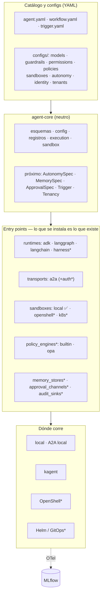

# Estrategia: de laboratorio de agentes a boilerplate para organizaciones

Este documento dice **hacia dónde va** la plataforma y en qué orden. El *cómo*
de cada decisión está en [`docs/adr/`](adr/); lo que ya existe, en
[`architecture.md`](architecture.md).

## Punto de partida

La base es sólida: un manifiesto neutro (`agents.platform/v1`) que construyen
ADK, LangGraph y LangChain; tools por MCP; delegación por A2A; kagent como
runtime de clúster; MLflow como backend de AgentOps; enforcement de guardrails,
permisos y techos; y un sistema de extensión por *entry points*.

La regla que hay que proteger mientras crece: **cambiar un agente nunca debería
requerir un release de la plataforma.**

## Qué le falta para una organización

| Hueco | Estado |
|---|---|
| `timeout_seconds`, `retry_attempts` y `budget.max_usd` declarados pero no aplicados | ✅ Fase 0 |
| Delegación A2A sin reintentos ni corte ante un agente caído | ✅ Fase 0 |
| Sin CI, sin escaneo ni SBOM, sin firma de imágenes | ✅ Fase 0 (`.github/workflows/ci.yml`) |
| **Sin ejecución aislada**: las tools son puras porque no había dónde ejecutar nada | 🟡 Fase 2: esquema + backend `local` |
| Un solo proveedor de modelo (Gemini) | ⏳ Fase 0, pendiente |
| A2A y MCP sin autenticación ni identidad de agente | ⏳ Fase 1 |
| Guardrails sólo léxicos; sin motor de políticas externo | ⏳ Fase 1 |
| Sin memoria, sin tareas largas, sin aprobación humana, sin disparadores | ⏳ Fase 3 |
| Mono-tenant, sólo kind; sin Helm/GitOps ni gestión de secretos | ⏳ Fase 4 |
| Sin scaffolding para que otro equipo arranque | ⏳ Fase 4 |

## Principio rector

Cada capacidad nueva entra igual que las que ya existen:

1. un **concepto neutro** en `agent-core` (esquema + perfiles en `configs/`),
2. un **grupo de entry points** en `agent_core/registry.py`,
3. uno o varios **paquetes** que lo implementan, instalables por separado.

Nada de OpenShell, Docker, OPA o Temporal dentro del core.
`tests/test_boundaries.py` lo comprueba.

## Arquitectura objetivo

`*` = pendiente.

## Hoja de ruta

### Fase 0 — Robustez de base

| | Qué | Estado |
|---|---|---|
| 0.1 | `timeout_seconds` y `retry_attempts` aplicados en los tres runtimes, en un sitio: `agent_core/execution.py`, alrededor de `Runtime.stream` | ✅ |
| 0.2 | `budget.max_usd` contabilizado con `model.pricing` (dólares por millón de tokens, en `configs/models.yaml`); LangGraph y LangChain cuentan además `max_tokens`, que antes sólo contaba ADK | ✅ |
| 0.3 | Cliente A2A: reintento sólo de lo que no llegó (conexión rechazada, 502/503/504), circuit breaker por URL | ✅ |
| 0.4 | CI: lint, tests (con la prueba Docker del sandbox), `validate` en todos los entornos, `eval --check`, docs generadas al día, build de imágenes + Trivy + SBOM; en etiquetas `v*`, push a GHCR y firma cosign sin claves | ✅ |
| 0.5 | Multi-proveedor de modelo (Anthropic, OpenAI, vLLM/NIM) en los `model.py` de cada runtime y en `release.yaml` | ⏳ |
| 0.6 | El host BYO de kagent no pasa todavía por `stream_with_policies` (lo ejecuta el SDK de kagent) | ⏳ |

### Fase 1 — Seguridad e identidad

1. **Identidad de agente**: SPIFFE/mTLS en clúster, OIDC/JWT fuera. `agent-a2a` y
   `agent-mcp` validan el token; la tarjeta A2A declara `securitySchemes`.
2. **Motor de políticas enchufable** (`agent_platform.policy_engines`): `builtin`
   (el `AllowDeny` actual) y `opa` (Rego), para reglas por tenant, por dato y por
   propósito — encaja con el caso dataspace y ODRL.
3. **Riesgo de cada tool** (`read | write | exec | network | money`): permisos y
   aprobaciones se expresan sobre el riesgo, no sólo sobre el nombre.
4. **Guardrails semánticos**: un tipo `classifier` (juez, LlamaGuard, NeMo
   Guardrails) como paquete opcional; los tipos léxicos no cambian.
5. **Auditoría persistente** (`agent_platform.audit_sinks`): OTel logs, fichero, SIEM.
6. **Secretos**: External Secrets / Vault en `deploy/`; `${VAR}` sigue igual.

### Fase 2 — Sandbox, casos tipo NVIDIA OpenShell

[NVIDIA OpenShell](https://docs.nvidia.com/openshell/latest/about/overview.html)
es un runtime de sandbox para agentes autónomos: políticas YAML declarativas
sobre ficheros, red, procesos e inferencia, aplicadas **fuera del proceso del
agente** (Landlock, seccomp, un proxy que permite, deniega o enruta cada
conexión saliente). Para esta plataforma es lo que kagent: un *runtime de
plataforma*, no un framework. Por eso entra como **backend**, no como concepto.

| | Qué | Estado |
|---|---|---|
| 2.1 | `spec.sandbox` neutro + perfiles en `configs/sandboxes.yaml` (`code-exec`, `dev-workspace`) | ✅ |
| 2.2 | Grupo `agent_platform.sandboxes`; backend `local` (Docker: sin red por defecto, raíz de sólo lectura, `nobody`, sin capabilities, tmpfs) en `platform/sandboxes/local` | ✅ |
| 2.3 | Tools `sandbox.exec`, `sandbox.run_python`, `sandbox.write_file`, `sandbox.read_file`, ligadas a cada agente y sujetas a `permissions.tools` | ✅ |
| 2.4 | Agente de ejemplo `python-executor` (`make caso-10`); `kagent render` rechaza un agente con sandbox en modo declarativo | ✅ |
| 2.5 | Backend `openshell` (`platform/sandboxes/openshell`): `render_policy` + CLI v0.1.x; `agentctl openshell policy` para auditar | ✅ verificado con OpenShell 0.1.5 (Landlock, egress por host, suite de `python-executor`) |
| 2.5b | Backend `sbx` (Docker Sandboxes, microVM por sandbox) en `platform/sandboxes/sbx` | ✅ verificado con sbx v0.42 |
| 2.5c | El proveedor lo elige el entorno (`sandbox.backend`, `AGENT_SANDBOX_BACKEND`), [ADR 0006](adr/0006-sandbox-es-decision-de-entorno.md) | ✅ |
| 2.6 | Backend `k8s`: pod por sandbox con gVisor/Kata (o el CRD `agent-sandbox` de Kubernetes SIGs), para el carril clúster y los agentes BYO | ⏳ |
| 2.7 | Runtime `harness`: un agente de coding externo (Claude Code, Codex, OpenCode) dentro de un sandbox, servido por A2A como un sub-agente más. `sbx create claude` ya lo hace del lado de Docker | ⏳ |
| 2.8 | `deploy/openshell/release.yaml`, simétrico a `deploy/kagent/release.yaml` | ⏳ |

Lo que el backend `local` **no** hace, y avisa al abrir: filtrar la salida por
nombre de host (Docker no sabe) y enrutar la inferencia por una pasarela. Para
eso está OpenShell. Y un contenedor comparte kernel con el host: sirve para
desarrollar, no es una frontera contra un atacante decidido.

### Consola — Langflow

| | Qué | Estado |
|---|---|---|
| C.1 | Evaluación crítica en 5 ejes ([`control-plane.md`](control-plane.md)) y [ADR 0005](adr/0005-langflow-como-consola.md): Langflow es la consola, no el motor | ✅ |
| C.2 | `agent-langflow`: `export` de agentes y workflows a flujos de nodos A2A; Langflow 1.12.8 + Postgres en loopback | ✅ verificado (agente, secuencial, paralelo) |
| C.3 | Deduplicación por `messageId` en `a2a serve` | ✅ |
| C.4 | Traza única Langflow → agente (`traceparent`) | ⏳ por defecto no se propaga; probar con el OTel de Langflow |
| C.5 | Autenticación A2A para sacar Langflow de loopback | ⏳ Fase 1 |

### Fase 3 — Agentes autónomos

1. **`spec.autonomy`** con niveles L0 (asistido) a L4 (autónomo supervisado);
   cada nivel exige techos, aprobaciones y un sandbox mínimo. `validate` rechaza
   un L3+ sin sandbox o sin aprobación para riesgo `write/exec/money`.
2. **Human-in-the-loop** (`spec.approvals`): pausa ante tools de cierto riesgo;
   canales enchufables (CLI, Slack, webhook, UI de kagent).
3. **Estado y memoria** (`spec.memory`): sesión (checkpointer de LangGraph,
   `SessionService` de ADK) y largo plazo, tras `agent_platform.memory_stores`.
   Cierra "A2A sin conversación" y "BYO sin checkpointer".
4. **Tareas largas**: `Task` + streaming SSE + `tasks/get`/cancel en `agent-a2a`;
   Temporal opcional para workflows de larga duración.
5. **Disparadores** (`kind: Trigger`): cron, webhook, cola, cambio en un repo; en
   clúster, CronJob/KEDA.
6. **Bucle de objetivo** planner → executor → critic como workflow del catálogo,
   con condición de parada y presupuesto.
7. **Evals de autonomía**: trayectorias (tool calls esperadas y prohibidas),
   red-team (inyección a través de la salida de una tool), métricas de seguridad.

### Fase 4 — Boilerplate organizacional

1. **`agentctl init`**: `org`, `domain`, `agent`, `tool`, `skill`, `eval`, con
   plantillas — agente + prompt + eval mínima + entrada en el release.
2. **Multi-tenant**: `catalog/<tenant>/…` y `configs/tenants/<tenant>.yaml` como
   capa nueva en `config/merge.py` (flota → tenant → agente → entorno).
3. **Despliegue productivo**: Helm chart + overlays + Argo CD; kind queda como "lab".
4. **Gobierno**: `CODEOWNERS` por dominio, ADRs, política de versiones del API
   (`agents.platform/v1` → `agentctl migrate`), eval mínima como puerta de `make deploy`.
5. **Adopción**: guía "de cero a tu primer agente", matriz de responsabilidades
   (plataforma · dueño del agente · seguridad), checklist de producción.
6. **Casos de referencia**: 11 = agente de coding en OpenShell, 12 = agente
   autónomo con disparador y aprobación humana, 13 = multi-tenant.
